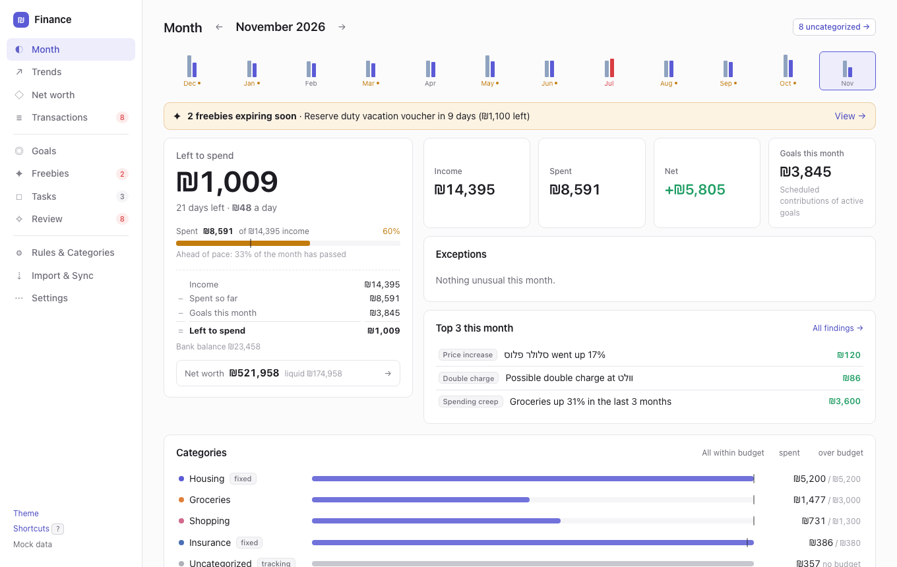
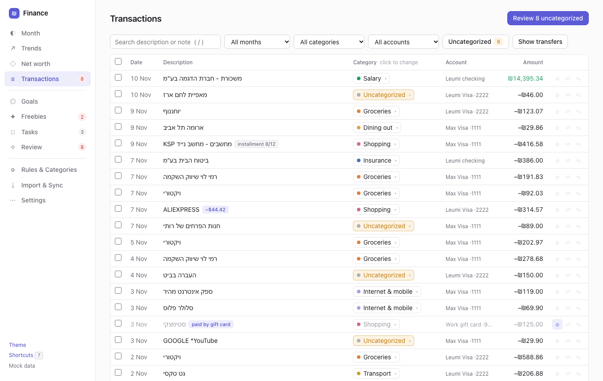
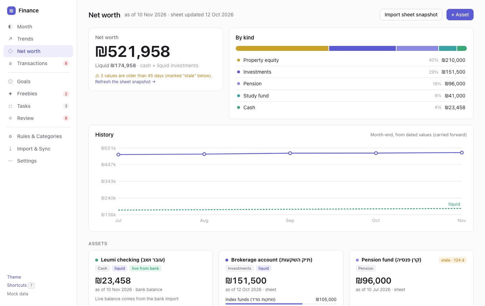
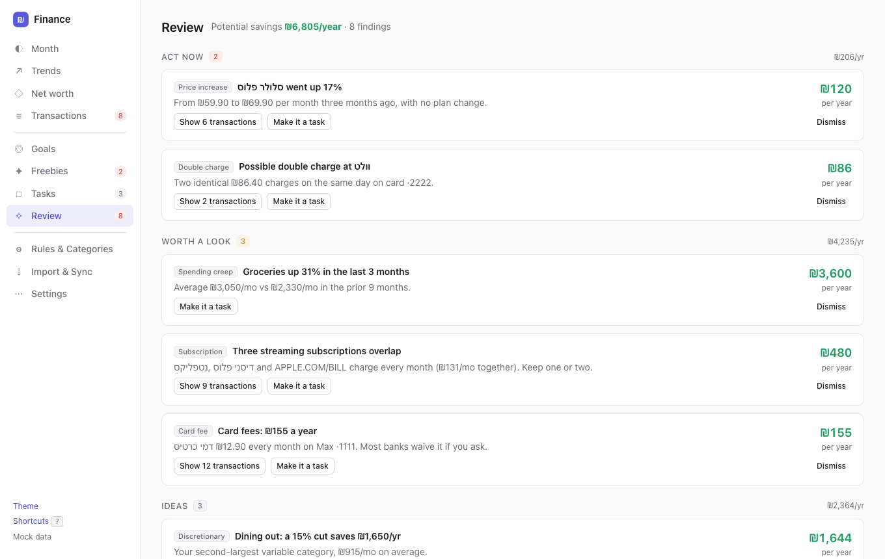
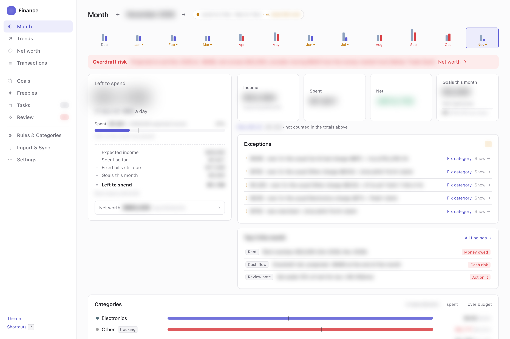
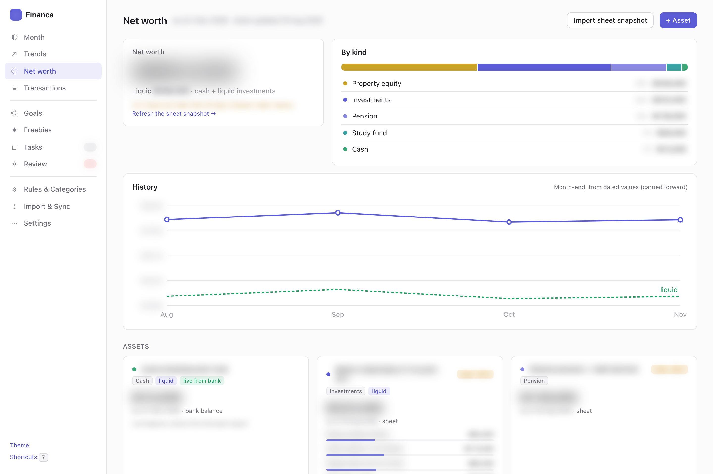
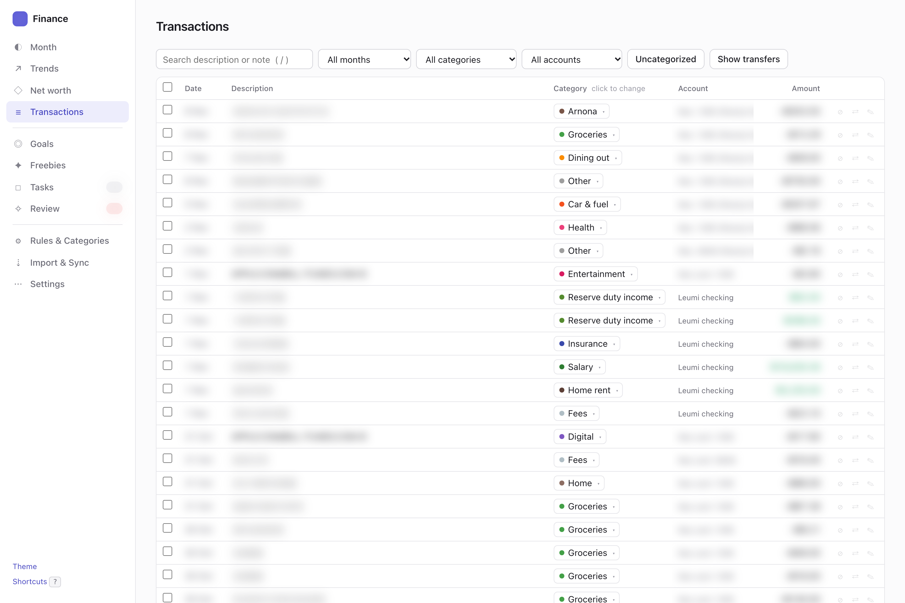
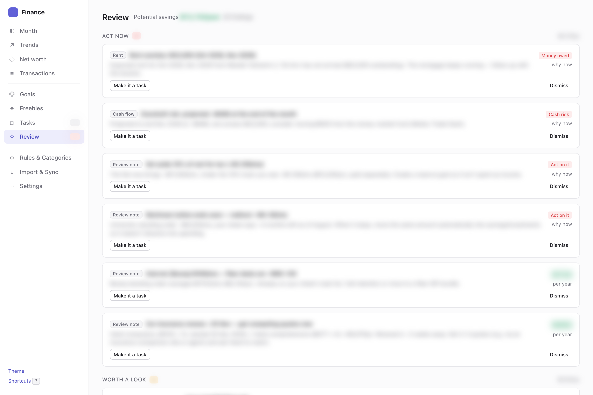

# Finance

A local personal-finance app for Israeli bank and credit-card data. Drop in your bank and card exports and it
shows each month's cashflow, what's left to spend, and where the money went. It also tracks budgets, goals, net
worth, freebies (gift cards, reserve-duty vouchers) and money-saving tasks. Everything runs on your machine, from
a Python server and a browser UI. Your data stays in one gitignored folder, and nothing is uploaded anywhere.

| Month | Transactions |
|---|---|
|  |  |
| **Net worth** | **Review** |
|  |  |

<sub>Screenshots use the built-in mock data (`?mock=1`). Every name and number in them is invented.</sub>

<details>
<summary><b>In real use</b> — a year and a half of real bank + card data, with every amount, date and merchant blurred</summary>

| Month | Net worth |
|---|---|
|  |  |
| **Transactions** | **Review** |
|  |  |

</details>

## Features

- **Import** Leumi (PDF / Excel), Max and Cal (xlsx), RiseUp history (CSV) and any CSV with date / description /
  amount. Re-imports and overlapping files are de-duplicated.
- **Cashflow month.** Card purchases count in the month they're billed, and bank lines that pay the card bill are
  transfers, so nothing is counted twice.
- **Categories that learn.** Fix a category once with "remember", and a rule handles that merchant from then on.
  You can preview what a rule matches before you save it.
- **Month view**: left to spend, overspend and attention flags, anomalies, and fixed charges vs. their usual amount.
- **Trends, forecast and "can I afford it?"** with p25 / p75 scenarios and a buffer.
- **Goals** with monthly contributions and step-ups (e.g. "add ₪800/mo once the car loan ends").
- **Net worth**: assets, liabilities, property and rent P&L, optionally imported from a Google Sheet snapshot.
- **Review**: duplicate charges, fees, subscriptions, price increases and category creep, each with an estimated
  yearly saving. You can turn any finding into a task.
- **Freebies**: gift cards, work perks and reserve-duty benefits, with expiry warnings.
- **Optional live sync** through [israeli-bank-scrapers](https://github.com/eshaham/israeli-bank-scrapers), with
  credentials kept in the macOS Keychain.

## Quick start (macOS / Linux)

Prerequisites:
- [uv](https://docs.astral.sh/uv/getting-started/installation/). Python 3.12 comes through uv, so you don't need a
  system Python.
- Node ≥ 22, but only for live sync and the RiseUp export.

```bash
git clone <this repo> finance && cd finance
./finance            # first run: installs deps, creates data/finance.db, opens http://127.0.0.1:8747
```

Then open **Import & Sync** and drop in your first files. You can also run it from the terminal:

```bash
./finance import ~/Downloads/statement.pdf ~/Downloads/max_export.xlsx
# or put files in data/inbox/ and run:
./finance import-inbox
```

Try the UI without any data at <http://127.0.0.1:8747/?mock=1>.

**Clickable app (macOS):** `scripts/make_mac_app.sh [--icon icon.png]` builds `~/Applications/Finance.app`. The app
starts the server if it isn't running and opens the browser. Re-run the script if you move the clone.

Other commands: `./finance serve [--port N]`, `sync`, `backup`, `export-csv`, `recategorize`, `tag-event`,
`import-sheet`, `apply-setup`, `export-setup`. Run `./finance --help` for the full list.

## Monthly routine

1. Download last month's files: the bank statement (Leumi PDF or Excel) and each card's export (Max / Cal xlsx).
2. Drop them on **Import & Sync**, or into `data/inbox/` and run `./finance import-inbox`. If live sync is set up,
   press **Sync** instead.
3. Open **Transactions → Review uncategorized**. Pick a category and tick *remember*, and the merchant is handled
   from then on.
4. Look at **Month** for flags and at **Review** for savings, and turn whatever is worth doing into a task.

## Your own setup

The defaults are generic: card-bill payments, internal transfers, savings deposits, salary (`משכורת`), reserve duty
(`מילואים`) and bank fees. Rules that describe *your* household go in `data/personal_setup.json`, which is
gitignored:
- the rent check's amount band
- a roommate's standing order
- your mortgage lender's or broker's name on the statement
- a one-off event category
- your net salary baseline

```bash
cp examples/personal_setup.example.json data/personal_setup.json   # edit it
./finance apply-setup        # idempotent; a brand-new database applies it automatically
./finance export-setup       # print what your current database would write there
```

Settings worth knowing (edit them in **Settings** or `settings` in the setup file):
- `cashflow_start_day`
- `salary_net_baseline`
- `cal_account_kind`: `card` (default) treats a Cal card like any credit card. Set `gift` if your Cal card is a
  prepaid gift card (e.g. a holiday present from work), so its spending is excluded from your cashflow.
- `sync_providers`

## Privacy

- Everything is local. The server binds to `127.0.0.1` only, and the UI loads nothing from a CDN.
- All data lives in `data/`: the database, imported files, backups and your setup file. `data/` is gitignored, and so
  are `*.pdf`, `*.xlsx`, `*.csv` and `*.db` outside the test fixtures.
- Only two features reach the network, and only when you run them:
  - live sync, which logs into your bank / card sites from your machine
  - the RiseUp export, which calls RiseUp's API with your token
- Daily automatic backups are kept in `data/backups/`.

## Adapting to your bank / card

**Supported out of the box**

| Source | File | Notes |
|---|---|---|
| Bank Leumi | PDF statement, Excel / HTML-as-`.xls` export | Signs come from running-balance deltas |
| Max (incl. bank-branded Max cards) | `.xlsx` "פירוט עסקאות" | Domestic + foreign sheets, installments, FX |
| Visa Cal | `.xlsx` | Gift card by default (`cal_account_kind`) |
| RiseUp | `data/riseup_transactions.csv` (see below) | History seed, merged with native rows |
| Anything else | CSV with date / description / amount (or debit + credit) | Hebrew or English headers |

**Add an importer (~50 lines).** Each importer turns a file into a list of `RawTxn`. The contract is in
`app/finapp/importers/base.py`:
1. Create `app/finapp/importers/<bank>.py` with a class that has `provider = "<bank>"`.
2. Give it `sniff(path, info) -> bool`. It recognises the file from `info.kind` (pdf / xlsx / xls / html / csv) and
   `info.header_text`, the normalised first rows.
3. Give it `parse(path) -> list[RawTxn]`. Amounts are signed (expense < 0) and `account_kind` is `bank`, `card` or
   `gift`.
4. Register it in `all_importers()` in `base.py`, most specific first.

`base.py` has helpers for the hard parts: `read_tables`, `find_header_row`, `parse_date`, `parse_amount` and bidi
cleanup. Put an invented fixture in `app/tests/fixtures/` (see `make_fixtures.py`) and tests in
`app/tests/test_importers.py`. `max.py` and `cal.py` are good templates.

**Live sync** runs `sync/scrape.mjs` (israeli-bank-scrapers 6.x, Puppeteer).
1. Run `cd sync && npm install`.
2. Store credentials in the Keychain with `sync/setup_credentials.sh [leumi max visaCal]`. Each one becomes a Keychain
   item `finapp-<provider>` with `username` / `password` entries, and nothing is written to disk.
3. Run `./finance sync`. The default providers come from the `sync_providers` setting (`leumi,max`).

The script has `leumi`, `max` and `visaCal` wired in. The library also supports other companies, for example
`hapoalim`, `discount`, `mizrahi`, `mercantile`, `otsarHahayal`, `beinleumi`, `massad`, `yahav`, `isracard`, `amex`,
`beyahadBishvilha`, `behatsdaa`, `pagi` and `oneZero`. Their login fields differ: some use an ID number, card6Digits
or user code instead of a username. To add one:
1. Add it to `COMPANY` / `FIELDS` in `sync/scrape.mjs`.
2. Add it to `PROVIDER_MAP` in `app/finapp/sync.py`.
3. Add it to `setup_credentials.sh`.

Check the library's README for each company's fields. On OTP: only OneZero supports a one-time code, through
`otpCodeRetriever` / `otpLongTermToken`. If any other provider asks for an SMS code at login, the scrape fails. Use
file import for that provider. `docs/integrations.md` has the details and known breakages.

**Card-bill payments must be transfers.** The bank line that pays a card bill (`מקס איט פיננ`, `לאומי ויזה`, `כאל`,
`ישראכרט`, …) has to be marked as a transfer, or that spending counts twice. The default patterns are the seeded
system rules in `SEED_RULES` in `app/finapp/db.py`, and you can see and edit them under **Rules & Categories**. For
a card company not listed there, add a rule with `"set_transfer": true` and category `Card payment`, either in the
UI or in `data/personal_setup.json`.

**Map a new provider's categories.** Card exports come with their own categories (Max קטגוריה, Cal ענף). Map them to
the app's categories in `PROVIDER_EXACT` (exact names) or `PROVIDER_KEYWORDS` (by keyword) in
`app/finapp/rules.py`. RiseUp categories map through `RISEUP_MAP` in the same file.

## Optional extras

- **RiseUp history.** Create a personal access token in RiseUp and keep it in the Keychain, then run:
  `RISEUP_PAT=$(security find-generic-password -a "$USER" -s riseup_pat -w) node scripts/riseup_export.mjs`.
  It writes `data/riseup_transactions.csv`; import it like any other file.
- **Net-worth sheet.** If you track savings in a spreadsheet, write a snapshot in the format of
  `examples/sheet_snapshot.example.json` to `data/sheet/snapshot_<date>.json`. Then run `./finance import-sheet`, or
  use the button on **Net worth**.
- **Claude Code monthly skill.** Copy `examples/claude-skill/finance-monthly/` to `~/.claude/skills/` and fill in your
  path. Claude then imports the month's files, refreshes the sheet snapshot and posts a review of your spending.

## Development

```bash
cd app && uv run pytest -q          # backend tests (invented fixtures only)
node --check app/ui/js/*.js         # UI syntax check
```

Layout: `app/finapp/` (FastAPI server, SQLite, importers, rules, analytics), `app/ui/` (vanilla JS, no build step),
`sync/` (scraper), `scripts/`, `examples/`, `docs/`. The data model, API and business rules are in
[docs/ARCHITECTURE.md](docs/ARCHITECTURE.md). Conventions are in [docs/DEVELOPING.md](docs/DEVELOPING.md).

## License

[MIT](LICENSE)
